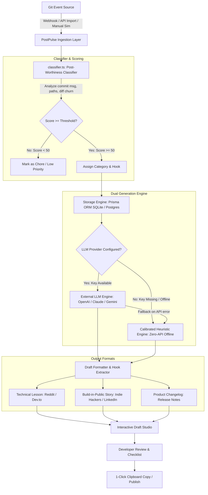

# TCT PostPulse: Build-in-Public Content Engine
## Comprehensive Technical & Operational Documentation

---

### Table of Contents
1. [Executive Summary & Product Vision](#1-executive-summary--product-vision)
2. [Why TCT PostPulse Is Useful (The Value Proposition & ROI)](#2-why-postpulse-is-useful-the-value-proposition--roi)
3. [What It Can Do (Core Features & Capabilities)](#3-what-it-can-do-core-features--capabilities)
4. [How It Works (System Architecture & Pipeline)](#4-how-it-works-system-architecture--pipeline)
5. [Data Models & Schema Reference](#5-data-models--schema-reference)
6. [The 10-Commit Quality Validation Benchmark](#6-the-10-commit-quality-validation-benchmark)
7. [API Endpoints & Integration Guide](#7-api-endpoints--integration-guide)
8. [Setup, Execution & Configuration Guide](#8-setup-execution--configuration-guide)
9. [Monetization, Growth & Future Roadmap](#9-monetization-growth--future-roadmap)

---

### 1. Executive Summary & Product Vision

**TCT PostPulse** is a specialized content generation and distribution engine designed specifically for indie hackers, micro-SaaS founders, and software engineers. It automates the translation of raw software development events (Git commits, pull requests, and GitHub releases) into authentic, high-converting content for developer communities—specifically **Reddit**, **Indie Hackers**, **LinkedIn**, **X/Twitter**, and **Public Changelogs**.

#### The Core Problem
To build a sustainable software business without venture capital, developers must build in public to attract initial traction and organic users. Reddit communities (such as `r/SideProject`, `r/webdev`, `r/programming`, and `r/SaaS`) represent the **#1 organic acquisition channel** for micro-SaaS products.

However, developers face critical roadblocks:
1. **Developer Exhaustion & Writer's Block:** After spending 4 to 8 hours solving a complex database deadlock or fixing a billing race condition, developers have zero cognitive energy left to craft persuasive, well-structured long-form articles.
2. **The "Corporate Marketing Fluff" Trap:** Standard generic AI chatbots (like standard ChatGPT prompts) default to hyper-promotional, corporate marketing clichés (*"🚀 Super thrilled to announce our next-gen synergy! In today's fast-paced digital world..."*). Developer communities immediately recognize, downvote, and report such posts as spam.
3. **Context Mismatch:** A database migration requires technical depth, SQL snippets, and post-mortem analysis. A UI/UX overhaul requires user psychology and onboarding metrics. A dependency bump should be filtered out entirely. Traditional tools lack this domain sensitivity.

#### The PostPulse Solution
PostPulse bridges the gap between the terminal and the public audience. By continuously monitoring git activity, filtering out chores, scoring the technical narrative potential (0–100), and calibrating the tone to sound like an authentic engineer sharing battle-tested lessons with peers, PostPulse turns everyday development into organic user acquisition.

---

### 2. Why PostPulse Is Useful (The Value Proposition & ROI)

| Factor | Without PostPulse | With PostPulse |
| :--- | :--- | :--- |
| **Time per Post** | 45–90 minutes of manual drafting, formatting, and proofreading | **Under 60 seconds** (review calibrated draft, verify checklist, click copy) |
| **Tone & Style** | Either too dry (raw commit log) or too spammy (generic AI hype) | **Authentic peer developer voice**: transparent about bugs, tradeoffs, and code logic |
| **Noise Filtering** | Founders waste time posting about routine dependency bumps or typo fixes | **Automated noise filter**: lockfiles and minor docs changes are penalized and silenced |
| **Distribution Coverage** | Developer usually writes for one platform (or none at all) | **1 commit generates 3 tailored formats** (Reddit technical lesson, Indie Hackers story, crisp changelog) |
| **Community Acceptance** | High risk of community downvotes or bans for promotional fluff | **High engagement**: follows tested formulas (bottleneck $\rightarrow$ symptom $\rightarrow$ fix snippet $\rightarrow$ takeaways $\rightarrow$ discussion question) |

#### Target Market
- **Solo Indie Hackers & Bootstrap Founders:** Builders who write 100% of the code and also have to handle 100% of the marketing.
- **Micro-SaaS & Open-Source Maintainers:** Teams needing to maintain public changelogs, release notes, and devlogs without hiring a dedicated content writer.
- **Developer Advocates & Technical Founders:** Engineers building an audience or technical reputation on X/Twitter, LinkedIn, and Reddit.

---

### 3. What It Can Do (Core Features & Capabilities)

#### 1. Multi-Channel Git Ingestion
- **GitHub Webhook Ingestion (`/api/webhooks/github`):** Automatically ingests `push` and `release` webhook payloads with cryptographic HMAC-SHA256 signature verification.
- **Public GitHub Repo Importer (`/api/github/import`):** Directly imports recent commit history from any public repository (`owner/repo`) via the GitHub REST API.
- **Custom Commit Simulator (`/api/events`):** Enables manual entry and simulation of commits with custom diffs, file lists, and descriptions to test content generation.

#### 2. Post-Worthiness Classifier & Noise Filter (`src/lib/classifier.ts`)
Calculates a **0–100 Post-Worthiness Score** using an algorithmic evaluation model:
- **Trivial Penalty:** Assigns low scores (15–20/100) to lockfile updates (`package-lock.json`, `pnpm-lock.yaml`, `cargo.lock`) and minor markdown typo fixes.
- **High-Impact Domain Boost:** Automatically categorizes commits into 8 distinct developer themes:
  1. `database_migration`: Schema migrations, indexing, lock contention, query optimization.
  2. `performance`: Latency optimization, N+1 queries, memory leaks, concurrency, streaming.
  3. `bug_war_story`: Tricky edge cases, production outages, concurrency races, race conditions.
  4. `security_auth`: Webhooks, HMAC verification, JWT token rotation, idempotency keys, OAuth.
  5. `ui_ux`: Eliminating modal wizards, onboarding redesigns, keyboard shortcuts, layout shifts.
  6. `new_feature`: Core customer-facing capabilities and integrations.
  7. `architecture`: Decoupling adapters, modularization, refactoring subsystems.
  8. `chore_internal`: Routine internal maintenance (filtered out from automatic posting).
- **Churn & Description Bonuses:** Weighs line churn depth (+additions/-deletions) and rewards descriptive commit bodies.

#### 3. Three Publishable Draft Formats per Event
For every qualifying commit, the engine crafts three distinct content pieces:
1. **Technical Lesson (Reddit `r/SideProject`, `r/webdev`, Dev.to, Hacker News):**
   - Structural Anatomy: Problem symptom $\rightarrow$ Naive assumption $\rightarrow$ The actual fix (with real code snippet / diff) $\rightarrow$ 3 practical takeaways $\rightarrow$ Open technical discussion question.
2. **Build-in-Public Story (Indie Hackers, LinkedIn, X/Twitter):**
   - Structural Anatomy: The founder struggle / metric hook $\rightarrow$ Why the task was delayed or what broke $\rightarrow$ What shipping it taught the builder $\rightarrow$ Question to fellow founders.
3. **Product Changelog (Release Notes, In-App Modals):**
   - Structural Anatomy: 1–3 crisp lines translating code churn into customer-centric value (e.g., *"⚡ 4x faster dashboard load times"* instead of *"refactor query index"*).

#### 4. Six Dynamic Tone & Angle Controls
Developers can re-tune the draft in real time using 6 specific angles:
- **Authentic & Raw:** Pragmatic, direct peer-to-peer developer tone.
- **Bug War Story:** Suspenseful, debugging-journey narrative.
- **Hard Lesson:** Focuses on mistakes made, naive assumptions, and painful lessons.
- **Spicy / Contrarian:** Challenges mainstream developer dogmas and popular tech stacks.
- **Founder Vulnerable:** Focuses on emotional friction, procrastination, and metric shifts.
- **Crisp & Minimal:** Ultra-condensed, bulleted, no-nonsense format.

#### 5. Interactive Draft Studio (`src/components/DraftStudio.tsx`)
- **Split-Screen Workspace:** Live Markdown editor on the left with formatted destination preview on the right.
- **Real-Time Readability Meters:** Word counter and estimated reading time indicator.
- **Developer Pre-Publish Checklist:** Interactive checklist ensuring code compiles, sensitive tokens/keys are stripped, and marketing hype is removed.
- **One-Click Clipboard Export:** Instant copy with visual confirmation.

#### 6. Developer Validation Benchmark Suite (`src/components/ValidationBenchmark.tsx`)
Includes a pre-seeded suite of 10 real-world developer commits spanning database optimizations, billing race conditions, UI redesigns, and dependency bumps. Allows developers to empirically grade output quality (**Ready As-Is**, **Light Edits**, **Heavy Edits**, **Trash**) and test the target $\ge 40\%$ publishability bar.

#### 7. Multi-Commit Weekly Founder Digest & Sprint Roundup (`src/components/WeeklyDigestModal.tsx`, `/api/digest`)
Synthesizes multiple selected commits into 3 unified weekly formats:
- **Founder Newsletter (Substack / Indie Hackers):** High-level strategic themes, metrics scorecard, and reflection questions.
- **Sprint Release Notes (Changelog):** Categorized customer notes (🚀 New Features, ⚡ Performance, 🛠️ Fixes, 🔧 Architecture).
- **Reddit "Week in Public" Developer Roundup:** Peer devlog designed for `r/SideProject` and `r/webdev`.

#### 8. 𝕏 Tweet Thread Splitter & Live Character-Counted Composer
- Automatically fragments long-form posts into sequential 280-character numbered tweets (`1/N` to `N/N`).
- Real-time character length meters with visual alerts for tweets exceeding the 280-character threshold.
- Individual tweet copy buttons, whole-thread copy, and direct "Tweet Opener" launchers.

#### 9. 1-Click Multi-Platform Direct Publisher & Share Hub (`src/components/PublishModal.tsx`)
- **Reddit Direct Submit:** Opens `reddit.com/r/{targetSub}/submit` pre-populated with formatted title and body.
- **𝕏 / Twitter Intent:** Launches `twitter.com/intent/tweet`.
- **LinkedIn & Hacker News Intent:** Direct share launchers.
- **Clean Markdown (.md) File Exporter:** 1-click download with structured YAML frontmatter.
- **Publication Tracker:** Records live post URL and renders persistent "Live Post" badges.

#### 10. Viral Headline & Hook Laboratory (`src/components/ViralHeadlinesModal.tsx`, `/api/headlines`)
Offers 5 psychologically distinct headline hooks per commit:
1. *The Outage / War Story*
2. *The Data / Latency Metric Win*
3. *The Contrarian Take*
4. *Founder Vulnerability*
5. *Practical Engineering Tutorial*

#### 11. Subreddit Matcher & Anti-Ban Community Guidelines
- Dynamically recommends top subreddits by domain (`r/PostgreSQL`, `r/webdev`, `r/SideProject`, `r/programming`, `r/netsec`).
- Provides community rules, required flairs, and self-promotion checklists to avoid moderation penalties.

#### 12. Power-User Productivity Suite
- **Multi-Commit Batch Operations:** Floating action bar to Batch Generate, Compile Digest, Export Markdown, or Dismiss.
- **Global Keyboard Shortcuts (`?` Key):** `J`/`K` navigation, `1`/`2`/`3` format switcher, `/` search focus, `Ctrl+S` save, `Ctrl+C` copy.
- **Non-Blocking Toast System:** Smooth, animated status feedback.


---

### 4. How It Works (System Architecture & Pipeline)

#### End-to-End Pipeline Workflow



#### Dual-Engine Generation Architecture
1. **Calibrated Heuristic Engine (`src/lib/generator.ts`):**
   - Works 100% offline out-of-the-box with **zero API keys required**.
   - Employs calibrated developer post templates tuned to high-engagement formulas for each specific category.
   - Extracts realistic SQL, TypeScript, and architectural diff snippets from the commit's metadata.
2. **External LLM Integration (`callLlmProvider`):**
   - Supports **OpenAI** (`gpt-4o`, `gpt-4o-mini`), **Anthropic** (`claude-3-5-sonnet`), and **Google Gemini** (`gemini-1.5-flash`).
   - Injects rigorous developer anti-hype rules via `buildSystemPrompt` (`src/lib/prompts.ts`), stripping influencer buzzwords.
   - Automatically falls back to the Calibrated Engine if external APIs fail or time out.

---

### 5. Data Models & Schema Reference

The data layer is managed with **Prisma ORM** (`prisma/schema.prisma`), supporting **SQLite** for zero-dependency local dev and **PostgreSQL** for containerized/production deployment, backed by a resilient JSON file fallback (`data/`).

#### 1. `Event` Model
Represents an ingested Git event (commit or release).
- `id`: Unique event identifier (e.g. `evt_commit_01`).
- `type`: `commit` | `release` | `pull_request`.
- `repo`: Repository name (`owner/repo`).
- `branch`: Target branch (`main`).
- `authorName`, `authorUsername`, `authorAvatarUrl`: Author attribution.
- `timestamp`: Event creation timestamp.
- `title`: First line of the commit message.
- `description`: Extended commit message body.
- `sha`, `shortSha`, `url`: Git hash and web link.
- `additions`, `deletions`, `totalFiles`: Code footprint churn metrics.
- `filesJson`: Array of modified files with filename, status, and patch snippets.
- `rawDiffSnippet`: Extracted code snippet or diff chunk.
- `worthinessScore`: 0–100 calculated score.
- `category`: Detected topic (`database_migration`, `performance`, etc.).
- `reasons`: List of explanations justifying the score.
- `recommendedHook`: Suggested headline hook for the post.
- `status`: `pending` | `drafted` | `published` | `dismissed`.

#### 2. `Draft` Model
Represents a generated publication piece tied 1:1 to an Event and Format.
- `id`: Unique draft identifier.
- `eventId`: Foreign key referencing `Event.id` (cascading delete).
- `format`: `technical_lesson` | `build_in_public` | `changelog`.
- `targetPlatform`: `reddit` | `indie_hackers` | `linkedin` | `x_twitter` | `changelog` | `dev_to`.
- `platformName`: Formatted display name.
- `title`: Generated title/hook.
- `content`: Markdown text.
- `tone`: Selected style (`authentic_raw`, `war_story`, etc.).
- `wordCount`: Word count integer.
- `publishChecklist`: Array of pre-publish safety checks.
- `estimatedReadTime`: Estimated read time string.
- `isEdited`: Boolean tracking manual edits.
- *Constraint*: `@@unique([eventId, format])` prevents duplicate drafts.

#### 3. `Settings` Model
Stores global founder voice and configuration.
- `id`: Singleton ID (`default`).
- `productName`: Name of the SaaS product.
- `productTagline`: Product value proposition.
- `targetAudience`: Target customer demographic.
- `founderVoiceBio`: Tone and background profile.
- `repoUrl`: Default GitHub repository.
- `githubWebhookSecret`: HMAC signature secret.
- `openaiApiKey`, `anthropicApiKey`, `geminiApiKey`: Optional LLM credentials.
- `preferredModel`: Default model choice (`gpt-4o-mini`).
- `minScoreToDraft`: Minimum worthiness score threshold (default: 50).
- `autoDraftOnWebhook`: Automatic draft generation flag.

#### 4. `ValidationGrade` Model
Tracks empirical ratings on the benchmark commits.
- `eventId`: Unique identifier of the evaluated event.
- `grade`: `ready_as_is` | `light_edits` | `heavy_edits` | `unpublishable`.
- `developerFeedback`: Qualitative developer notes.

---

### 6. The 10-Commit Quality Validation Benchmark

A core tenet of PostPulse is objective quality measurement. Standard AI tools fail because their outputs are either discarded as hallucinations or require complete rewrites.

#### The Quality Hypothesis & Target Bar
> **The Quality Bar:** Generate drafts from 10 diverse, real-world developer commits.
> **Pass Rule:** At least **4 out of 10 (40%)** must be rated **"Ready As-Is"** or **"Light Edits Needed"** by an experienced engineer. If fewer than 4 meet this bar, the content engine is deemed insufficient for production use.

#### The 10 Seed Benchmark Commits

| # | Commit Title | Detected Category | Score | Evaluation Focus |
| :- | :--- | :--- | :-: | :--- |
| **01** | `perf(db): add composite partial index on events(org_id, created_at)` | `database_migration` | 95 | Technical depth, SQL `CONCURRENT` index syntax, zero-downtime explanation. |
| **02** | `fix(billing): handle stripe webhook race condition with atomic redis idempotency lock` | `security_auth` | 92 | SaaS architecture, double-provisioning vulnerability, Redis atomic lock snippet. |
| **03** | `ui(editor): replace 3-step setup modal with split-view live preview` | `ui_ux` | 85 | User friction, conversion drop-off analytics (28% drop), UX rationale. |
| **04** | `perf(export): stream CSV downloads directly instead of buffering 50MB strings` | `performance` | 90 | Node.js memory leaks, V8 heap crash prevention, `TransformStream` pattern. |
| **05** | `fix(auth): prevent flash of unauthenticated state during JWT token rotation` | `security_auth` | 88 | Frontend state race condition, token rehydration, optimistic local cache. |
| **06** | `feat(notifications): add multi-channel webhook dispatcher with exponential backoff` | `new_feature` | 84 | Worker resilience, dead-letter queues, customer integration value. |
| **07** | `perf(cache): implement stale-while-revalidate for public metadata endpoints` | `performance` | 95 | Edge CDN caching, Cloudflare cache headers, 82% origin load reduction. |
| **08** | `refactor(core): decouple git parser from vendor APIs to support GitLab/Gitea` | `architecture` | 90 | Adapter design pattern, codebase maintainability, technical debt elimination. |
| **09** | `chore(deps): bump tailwindcss from 3.4.1 to 3.4.17` | `chore_internal` | 50 | **Negative Control**: Verifies that routine lockfile bumps are scored low. |
| **10** | `docs: fix broken link in CONTRIBUTING.md and typo in install guide` | `chore_internal` | 63 | **Negative Control**: Verifies that simple documentation fixes do not trigger hype posts. |

---

### 7. API Endpoints & Integration Guide

| Route | Method | Purpose | Key Parameters / Body |
| :--- | :---: | :--- | :--- |
| `/api/events` | `GET` | Fetch all monitored git events sorted by timestamp. | None |
| `/api/events` | `POST` | Simulate and insert a custom commit. | `{ title, description, files, stats }` |
| `/api/events/[id]` | `PATCH` | Update event status (dismiss, publish). | `{ status: "dismissed" \| "published" }` |
| `/api/events/[id]/generate` | `POST` | Generate or regenerate drafts for an event. | `{ format?: DraftFormat, tone?: ToneStyle }` |
| `/api/headlines` | `GET` | Fetch 5 high-converting viral headline angles for an event. | `?eventId=...` |
| `/api/digest` | `POST` | Compile selected commits into a Weekly Founder Digest (Newsletter, Release Notes, Reddit Devlog). | `{ eventIds?: string[] }` |
| `/api/drafts` | `GET` | Fetch all saved content drafts. | None |
| `/api/drafts/[id]` | `PATCH` | Save user edits to title, body, tone, or publishedUrl. | `{ title, content, tone, publishedUrl, publishChecklist }` |
| `/api/settings` | `GET` | Fetch current founder voice and engine settings. | None |
| `/api/settings` | `POST` | Update settings or trigger database seed reset. | `{ productName, founderVoiceBio, action: "reset_seed" }` |
| `/api/github/import` | `POST` | Import recent commits from any public repository. | `{ repoUrl: "owner/repo" }` |
| `/api/webhooks/github` | `POST` | Ingest real GitHub webhook events (`push`, `release`). | Headers: `x-hub-signature-256`, `x-github-event` |
| `/api/validation` | `GET` | Get benchmark metrics and evaluated items. | None |
| `/api/validation` | `POST` | Grade a commit or trigger batch generation. | `{ action: "rate_commit" \| "batch_generate_all" }` |

#### Webhook Security Verification
The webhook handler (`src/app/api/webhooks/github/route.ts`) calculates an HMAC-SHA256 signature using the shared secret and executes constant-time buffer comparison (`crypto.timingSafeEqual`) to prevent timing attack vulnerabilities.

---

### 8. Setup, Execution & Configuration Guide

#### Prerequisites
- **Runtime**: **Bun** (v1.4+) or **Node.js** (v18.0.0+ / v20+ / v24).
- **Package Manager**: `bun` or `npm`.

#### 1. Quick Start with Local SQLite (Zero-Config Default)
```powershell
# 1. Install dependencies with Bun (or npm)
bun install

# 2. Synchronize schema and push to local SQLite database (prisma/dev.db)
bun run db:push

# 3. Seed default settings, 10 benchmark commits, and validation grades
bun run db:seed

# 4. Verify database status
bun run db:verify

# 5. Start the Next.js full-stack development server
bun run dev
```
Open **`http://localhost:3000`** in your browser.

#### 2. Production Deployment with Neon Serverless PostgreSQL
PostPulse natively includes `@prisma/adapter-neon` and `@neondatabase/serverless` for high-throughput, connection-pooled serverless PostgreSQL.

1. **Configure Neon Connection in `.env` or hosting environment (e.g., Vercel, Railway):**
   ```ini
   # Pooled connection URL from Neon Console (Dashboard -> Connection Details):
   DATABASE_URL="postgresql://[user]:[password]@[endpoint]-pooler.[region].aws.neon.tech/[dbname]?sslmode=require"

   # Optional direct connection URL for unpooled migrations:
   DATABASE_URL_UNPOOLED="postgresql://[user]:[password]@[endpoint].[region].aws.neon.tech/[dbname]?sslmode=require"
   ```

2. **Synchronize & Push to Neon:**
   ```powershell
   # Configure Prisma schema for PostgreSQL and generate client
   bun run db:neon

   # Push schema tables and indexes to Neon
   bun run db:push

   # Seed initial data to Neon
   bun run db:seed
   ```

3. **Automatic Provider Detection in CI/CD:**
   When running `bun run build` or deploying to production, `scripts/prepare-db.mjs` automatically inspects `DATABASE_URL`. If a PostgreSQL URL is detected, it configures `provider = "postgresql"` and generates the Neon Prisma Client before compiling Next.js. If `DATABASE_URL` points to SQLite (`file:./dev.db`), it configures SQLite automatically.

#### 3. Automated Test Suites
Run the full test suite with Bun or Node:
```powershell
# Runs both feature engine tests and live API endpoint verification:
bun test
```

#### 3. Connecting Your GitHub Repository
1. In your GitHub repository, navigate to **Settings** $\rightarrow$ **Webhooks** $\rightarrow$ **Add webhook**.
2. **Payload URL:** `https://your-domain.com/api/webhooks/github`
3. **Content type:** `application/json`
4. **Secret:** Matches `GITHUB_WEBHOOK_SECRET` in PostPulse Settings (default: `dev_secret_content_engine_123`).
5. **Events:** Check **Pushes** and **Releases**.
6. Alternatively, use the **Connect GitHub Repo** button in the PostPulse UI to import commits via the GitHub API without setting up webhooks.

---

### 9. Monetization, Growth & Future Roadmap

#### Pricing & Business Model
- **Solo Indie Tier ($19/month):**
  - Unlimited commits from up to 3 personal GitHub repositories.
  - Automated Post-Worthiness classification and noise filtering.
  - 3 formats (Reddit technical lesson, Indie Hackers story, changelog).
  - Built-in calibrated engine + optional personal LLM keys.
- **Pro Maker Tier ($29/month):**
  - Unlimited repositories.
  - Full multi-LLM integration (Anthropic Claude 3.5 Sonnet, OpenAI GPT-4o, Google Gemini).
  - Custom brand voice configuration and tailored checklist rules.
- **Team / Studio Tier ($49/month):**
  - Multiple team contributors and organizational repos.
  - Shared validation benchmark dashboard.
  - Automated Slack/Discord webhook broadcasts on publishable drafts.

#### Future Product Roadmap
1. **Automated Subreddit Sentiment & Rules Analyzer:** Checks destination subreddit guidelines (e.g. self-promotion caps, flair requirements) prior to posting.
2. **Direct Reddit & Dev.to API Publishing:** Optional one-click publishing directly into drafts on Reddit or Dev.to via OAuth.
3. **Interactive Code Diff Visualizer:** Automatically render beautiful, shareable syntax-highlighted carbon-style code images directly from git diffs for Twitter/LinkedIn posts.
4. **GitLab & Bitbucket Webhook Adapters:** Broaden git provider support using the decoupled adapter architecture (`GitProviderInterface`).
